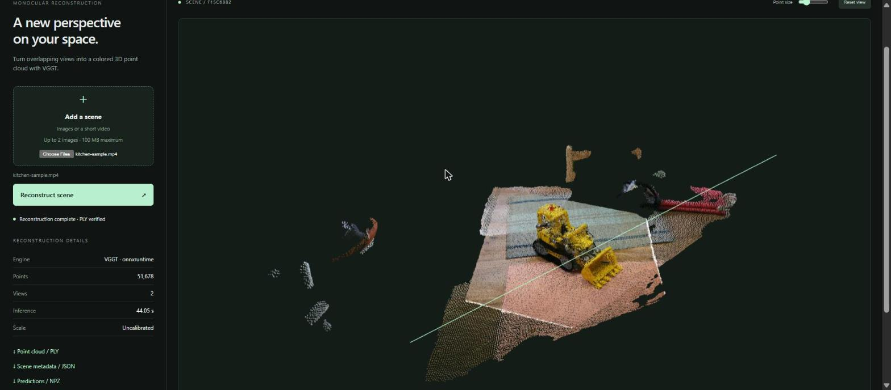

# SPECTRA — two-view 3D reconstruction from video with VGGT

**CraftifAI PipeGen Buildathon · Track A · Participant CRA003**

**In one line:** SPECTRA turns a short video of a static scene into a colored 3D point cloud
and camera positions using VGGT-1B, and sends out a PLY file plus a JSON `geometry_ready` event.



*Real result: two frames from `kitchen-sample.mp4` → VGGT-1B (ONNX Runtime, CPU) → 51,678-point
cloud with the camera path (green line), shown in the SPECTRA viewer.*

## Status at a glance

| Item | Status | Evidence |
|---|---|---|
| Official `facebook/VGGT-1B` checkpoint, SHA256 verified, loaded | **Verified** | [`checkpoint_verification.txt`](deliverables/evidence/checkpoint_verification.txt) |
| Real PyTorch inference → ONNX export → ONNX Runtime parity (max depth error 4.1e-5) | **Verified** | [`onnx_parity_report.md`](deliverables/evidence/onnx_parity_report.md) |
| End-to-end video → VGGT → PLY + JSON event (CPU, ONNX Runtime) | **Verified** | [`sample_output/`](deliverables/evidence/sample_output), [`e2e log`](deliverables/evidence/logs/e2e_onnx_cpu_run1.txt) |
| Web viewer (Flask + Three.js) showing the result | **Verified** | [`viewer_*.jpg`](deliverables/evidence) |
| PipeGen Requirement → Pipeline IR → Model → Compiler → Run | **Blocked** | see [Limits](#what-it-does-not-handle-yet) |
| TensorRT engine, PipeGen speed report, Pipeline IR screenshot | **Not produced** | — |

Nothing in this repository is simulated: every number below comes from a file in
`deliverables/evidence/`.

## Who is it for, and what changes for them?

A disaster-response or robotics team member who needs the layout of a room they cannot
safely walk through. Today they scroll through photos, or need a LiDAR scanner or a slow
multi-photo reconstruction. With SPECTRA, two frames from a phone video give camera poses and
a 3D point cloud (51,678 points in our test) with no scanner and no calibration, in about one
minute on a laptop CPU. Scale is relative, not metres.

## What the pipeline sends out, and who acts on it

After each reconstruction SPECTRA writes:

- `cloud.ply` — colored point cloud, re-read through Open3D to verify it before anything is announced;
- `metadata.json` — camera intrinsics/extrinsics and centers, bounds, runtime, model SHA256;
- `events.jsonl` — the actionable event, emitted only after real geometry exists:

```json
{"schema_version": 1, "event": "geometry_ready", "action": "inspect_reconstruction",
 "backend": "onnx", "point_count": 51678, "scale": "arbitrary; uncalibrated",
 "ply": ".../cloud.ply", "metadata": ".../metadata.json", "pipegen_execution_verified": false}
```

The operator inspects the cloud in the SPECTRA viewer; robotics software can consume the PLY
and JSON directly. Real sample: [`deliverables/evidence/sample_output/`](deliverables/evidence/sample_output).

## What the pipeline does, step by step

1. Decode the input video.
2. Sample two overlapping frames.
3. VGGT pad-preprocess each to 518×518 and pack side by side into one `1×3×518×1036` FP32 input.
4. Run VGGT-1B: aggregator backbone + camera and depth heads (point-map and tracking heads disabled).
5. Decode camera poses from `pose_enc` [1,2,9].
6. Unproject `depth` [1,2,518,518] with VGGT intrinsics/extrinsics into 3D points.
7. Keep confident points (`depth_conf`), voxel/outlier filtering with Open3D.
8. Write PLY + metadata JSON, emit the `geometry_ready` event, show in the viewer.

Built outside PipeGen: a custom ONNX export of VGGT (fixed two-view input, external weight file
because the model exceeds 2 GB). ONNX Runtime first rejected the export because upstream
`make_sincos_pos_embed` mixes float32 and float64 in an Einsum; SPECTRA stores those four
small tables as float32 after export (upstream VGGT untouched), and the result matches PyTorch
within the original tolerances — see [`onnx_parity_report.md`](deliverables/evidence/onnx_parity_report.md).

## Input tested

`artifacts/kitchen-sample.mp4`, built by `scripts/make_sample_video.py` from the real kitchen
scene images in upstream VGGT's examples (8 frames, 4 fps). Not newly filmed footage.

## How fast, on what hardware

Measured on **CPU only** (Intel Core i5-12450H, Windows 11, ONNX Runtime 1.23.2):

| Measurement | Value | Source |
|---|---|---|
| VGGT forward pass (2 views) | 37.7 s | `sample_output/metadata.json` → `runtime.forward_seconds` |
| Full two-view reconstruction | 63.4 s | `metadata.json` → `inference_seconds` |
| Same, second run through the viewer | 44.1 s | `viewer_1_result.jpg` |

GPU available: NVIDIA RTX 3050 Laptop, 4 GB, driver 595.76. **No GPU/TensorRT timing and no
PipeGen speed report exist yet.**

## What it does not handle yet

- **PipeGen stages not run.** PipeGen 0.5.1 (downloaded, SHA256 in
  [`pipegen_install_log.txt`](deliverables/evidence/pipegen_install_log.txt)) needs WSL2 + Docker +
  a ~12 GB DeepStream image. WSL2's own download timed out twice on a 0.1–0.2 MB/s connection
  ([`wsl_install.txt`](deliverables/evidence/logs/wsl_install.txt)). The validated ONNX bundle and
  [`pipegen/requirement.md`](pipegen/requirement.md) are ready for PipeGen's custom-model flow
  ([`docs/RTX5060_HANDOFF.md`](docs/RTX5060_HANDOFF.md)).
- No TensorRT engine yet; FP32 VGGT-1B weights (4.6 GB) exceed the 4 GB GPU, so FP16 is planned.
- Two views per reconstruction; separate reconstructions are not merged.
- Scale is relative (not metres).
- Tested on one indoor scene.

## Run it

```powershell
git clone --recurse-submodules https://github.com/atharv-namdeo/CraftifAIHackathon_CRA002.git
cd CraftifAIHackathon_CRA002
py -3.12 -m venv .venv; .venv\Scripts\Activate.ps1
python -m pip install torch==2.7.1 torchvision==0.22.1 --index-url https://download.pytorch.org/whl/cpu
python -m pip install "numpy<2" Pillow einops safetensors huggingface_hub -r requirements-spectra.txt -r requirements-export.txt
python -m pip install --no-deps -e ./vggt
python scripts/fetch_checkpoint.py                      # downloads + SHA256-verifies VGGT-1B (~5 GB)
powershell -File scripts/run_export_windows.ps1 -Output artifacts/vggt-onnx-run2   # real export + parity
python scripts/make_sample_video.py
python -m spectra.deployment.reference artifacts/kitchen-sample.mp4 --backend onnx --device cpu `
  --bundle artifacts/vggt-onnx-run2 --output artifacts/e2e-run
# Viewer:
$env:SPECTRA_BACKEND='onnx'; $env:SPECTRA_DEVICE='cpu'; $env:SPECTRA_MAX_FRAMES='2'
$env:SPECTRA_DEPLOYMENT_DIR="$PWD\artifacts\vggt-onnx-run2"; python -m spectra.app   # http://127.0.0.1:5000
```

Large files are not in Git: checkpoint (`artifacts/checkpoints/VGGT-1B`, 5.03 GB) and ONNX bundle
(`artifacts/vggt-onnx-run2`, 4.6 GB); both are reproduced by the commands above.

---

# Technical details

VGGT is the only model. The official upstream repository is preserved in `vggt/`,
commit `a288dd0f14786c93483e45524328726ab7b1b4ce`, with no source/pin changes.

## Start here

Clone this repository with its pinned upstream VGGT dependency:

```bash
git clone --recurse-submodules https://github.com/arshpreet-svg/spectra-vggt.git
cd spectra-vggt
```

For an existing clone, run `git submodule update --init --recursive`.

For the complete **export → PipeGen → engine comparison → DeepStream → viewer**
commands, read [VGGT/PipeGen handoff](docs/VGGT_PIPEGEN.md).
Supply [the requirement](pipegen/requirement.md) to PipeGen. The architecture JSON is
an authored reference graph; preserve PipeGen's actual generated PIR separately.

## Install the application/export environment

Python 3.12 recommended. From this directory in an existing Linux/WSL environment:

```bash
python3.12 -m venv .venv
source .venv/bin/activate
python -m pip install torch==2.7.1 torchvision==0.22.1 --index-url https://download.pytorch.org/whl/cu128
python -m pip install 'numpy<2' Pillow huggingface_hub einops safetensors
python -m pip install -r requirements-spectra.txt -r requirements-export.txt
python -m pip install --no-deps -e ./vggt
python scripts/preflight.py
```

For the local Mac, install the same torch/torchvision pair from the normal PyPI index,
without the CUDA index argument. Native Windows uses `py -3.12 -m venv .venv` and
`.venv\Scripts\Activate.ps1`. PipeGen itself requires its documented Linux setup.

The separately installed runtime uses newer PyTorch than upstream's torch==2.3.1 pin
because RTX 50-series Blackwell support needs a newer CUDA build. The upstream dependency
file is unchanged. The target pair must pass a real CUDA operation on your actual laptop.
See https://pytorch.org/blog/pytorch-2-7/ and `scripts/preflight-windows.ps1`.

Use PipeGen's selected DeepStream environment and matching TensorRT/`pyds` bindings;
these are not ordinary portable pip dependencies and have not been installed on this Mac.
Approve administrator, Docker and group changes yourself before running vendor setup.

## Smallest original-model inference

```bash
export HF_HOME="$PWD/artifacts/hf-cache"
python scripts/upstream_smoke.py
```

This uses one bundled real kitchen image, actual pretrained weights and upstream
preprocessing. Success evidence is written only after the forward pass. The roughly
5 GB checkpoint download failed in this session with curl error 92 (HTTP/2 CANCEL).
The 681 MiB `artifacts/model.safetensors` is incomplete and must not be loaded.
The complete official safetensors SHA256 is
`f164acf60724910d8fe1578bb499d800850c7bb0948db7555c413f9fbe60467e`.
A complete verified local checkpoint directory can be selected with `SPECTRA_MODEL_ID`.

## Export for PipeGen

```bash
python -m spectra.deployment.export \
  vggt/examples/kitchen/images/00.png vggt/examples/kitchen/images/01.png \
  --output artifacts/vggt-onnx --device cpu
```

The wrapper packs two padded 518x518 views into a conventional `[1,3,518,1036]` RGB
input, then unpacks them within ONNX before joint VGGT inference. Outputs are original
pose encoding, depth and confidence. Do not normalize twice: VGGT handles ImageNet
normalization internally. External graph weight files must travel with the ONNX file.

The exporter checks fixed-grid specialization equivalence and ONNX Runtime agreement
against actual PyTorch predictions. A valid manifest is written only after these pass.
No random-weight fallback exists. Local synthetic test bundles are labeled and rejected
by production runtimes. A full-model export can require considerable host RAM.

Import the validated bundle/repository through PipeGen's custom model workflow, compile
there, retain its actual engine/speed report, and follow [the target guide](docs/VGGT_PIPEGEN.md).
No unsupported PipeGen CLI or generated IR format is invented here.

## Local reconstruction and viewer

PyTorch baseline:

```bash
python scripts/make_sample_video.py
python -m spectra artifacts/kitchen-sample.mp4 --device cuda --max-frames 2
python -m spectra.app
```

For a real engine compiled by PipeGen:

```bash
export SPECTRA_BACKEND=tensorrt
export SPECTRA_DEPLOYMENT_DIR="$PWD/artifacts/vggt-onnx"
export SPECTRA_ENGINE_PATH=/home/USER/pipegen-export/vggt.engine
python -m spectra.app
```

Open **http://127.0.0.1:5000** and upload two overlapping images or a short video.
The ONNX/TensorRT adapters require exactly two sampled views. The PyTorch baseline
also supports one view. The supplied sample video uses real-scene upstream images;
it is not newly filmed footage. Viewer assets are pinned/vendored Three.js 0.170.0.

Configuration in `spectra/config.py`: `SPECTRA_BACKEND=pytorch|onnx|tensorrt`,
`SPECTRA_DEPLOYMENT_DIR`, `SPECTRA_ENGINE_PATH`, `SPECTRA_DEVICE=auto|cpu|cuda`,
`SPECTRA_MAX_FRAMES`, `SPECTRA_OUTPUT_DIR`, `SPECTRA_MODEL_ID`. Start with two frames
and measure available memory. Runtime selection is explicit; there is no silent fallback.

The loopback server permits one reconstruction at a time. Artifacts: `cloud.ply`,
`metadata.json`, `predictions.npz`. PLY is read back through Open3D to check validity.
JSON records runtime and engine hashes when present; it does not assert PipeGen provenance.

**Scale is arbitrary.** Translations and voxel sizes are not metres. Independent windows
are not registered. This is bounded reconstruction, not continuous loop-closed SLAM.
Review upstream checkpoint/code licensing before sharing or using commercially.

## Verification

```bash
python -m pytest -q
python -m compileall -q spectra scripts
```

Tests cover atlas order, upstream RoPE equivalence, ONNX/ORT adapter roundtrip with an
explicit synthetic attention model, known-camera geometry decoding, frame sampling,
PLY readback, Flask upload/export and failure paths. They are not model benchmarks.
See `evidence/status.json` for implementation/test/target-verification distinctions.

Earlier detection-adapter source remains inactive. No detector or FirmGen project is
part of the active pipeline. The source handoff omits checkpoints, virtualenv and Git
history; the local `vggt/` checkout retains its upstream history.
